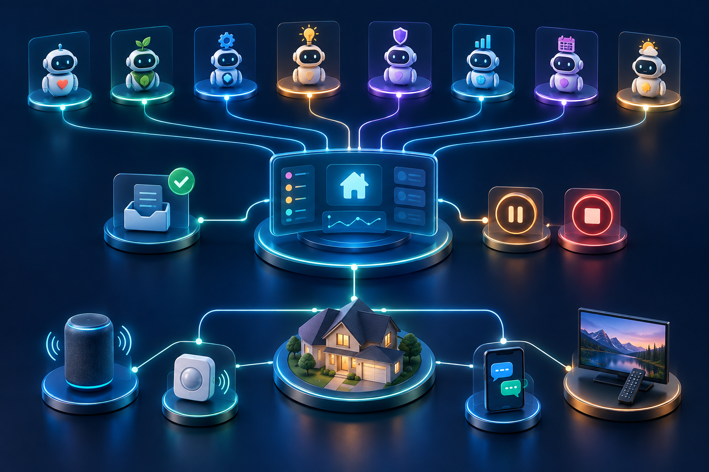
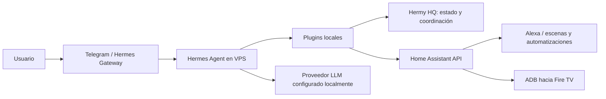

# Hermes Agent Personalizado

Banner del proyecto Hermes Agent, distribuido con el código fuente de [Nous Research](https://github.com/NousResearch/hermes-agent). La marca y el diseño pertenecen a sus titulares.

Repositorio público de una instalación extendida de **Hermes Agent**, desarrollado originalmente por **Nous Research**, con personalizaciones de REY para automatización, integración de herramientas y coordinación con Hermy HQ. Reúne un snapshot de código y personalizaciones publicables; **no contiene todos los módulos privados ni constituye una copia íntegra y reproducible del VPS**. La versión/tag upstream exactos del runtime productivo no pudieron verificarse en la auditoría del 20 de noviembre de 2026.

## Mapa visual de la integración

La ilustración resume visualmente el ecosistema. El diagrama Mermaid y las secciones siguientes describen los flujos implementados con etiquetas precisas.

## Qué incluye

- Árbol del proyecto Hermes Agent (rama activa exportada como un commit nuevo, sin historial previo).
- Plugins propios para Alexa, presencia en red, enrutamiento, protecciones de herramientas, Hermy HQ, QBitTorrent y servicios personalizados.
- Las dos modificaciones locales activas del gateway y su prueba asociada.
- Ejemplos de configuración y unidades de servicio, revisados para publicar sin credenciales.
- Una comprobación de GitHub Actions adaptada a este repositorio: valida imágenes enlazadas y detecta archivos de entorno, bases de datos, logs y cachés de runtime.
- Integración conceptual con Hermy HQ y Home Assistant; ADB para control de Fire TV se documenta y se comparte en el repositorio de Home Assistant.

## Capacidades y estado verificado (20 de noviembre de 2026)

La auditoría realizada desde la Dell G15 documentó **42 elementos evaluados**: 7 verificados dentro de pruebas acotadas, 25 implementados sin prueba E2E, 5 parciales, 4 inactivos y 1 no encontrado. Se identificaron **20 plugins propios habilitados** en el inventario de configuración, sin que ello demuestre 20 flujos operativos de extremo a extremo.

En el despliegue se observaron configuraciones o código para Telegram, soporte WhatsApp, Composio/MCP, qBittorrent/Gopeed, TMDB, Video2Implementation/YouTube, Job-Apply/CV, Home Assistant/Alexa/Fire TV, nodos subordinados, supervisión, memoria, copias de seguridad y políticas de modelos. No todas esas integraciones están activas, publicadas o validadas en producción.

**Pruebas acotadas:** qBittorrent 72/72; WebUI y endpoint de salud Qwen HTTP 200. La comprobación de salud de Qwen no demuestra inferencia; tampoco se acreditaron E2E de Telegram, WhatsApp, calendario, postulaciones, restauración de backups ni control de dispositivos durante esta auditoría.

- **[Inventario de funcionalidades, estados y limitaciones](docs/CAPABILITIES-2026-11-20.md)**: distinción entre herramientas nativas de Nous Research y desarrollos de REY.
- **[Hermy HQ y sus ocho agentes configurados](https://github.com/Reynaldo8509/hermy-hq-personalized/blob/sync/hermy-hq-20261120/docs/AGENTS-STATUS-2026-11-20.md)**: capacidades, coordinación y limitaciones.
- **[Sincronización de código para revisión (PR #1)](https://github.com/Reynaldo8509/hermes-agent-personalized/pull/1)**: cinco plugins genéricos añadidos en `customizations/plugins/`, sin hacer merge a `main`.

Las integraciones no publicadas por contener información de dispositivos, identidad o credenciales se documentan solamente a nivel funcional.

## Arquitectura

El diagrama describe las integraciones configuradas en este despliegue; los proveedores y endpoints se configuran en el servidor. No hay tokens ni direcciones privadas en este repo.

## Proyectos relacionados

- [Home Assistant Personalized](https://github.com/Reynaldo8509/home-assistant-personalized)
- [Hermy HQ Personalized](https://github.com/Reynaldo8509/hermy-hq-personalized)

## Inicio

Consulta `docs/DEPLOYMENT.md` para dependencias, instalación del código y plugins, configuración local y comprobaciones de operación. `custom/plugins/` conserva las personalizaciones del snapshot inicial; `customizations/plugins/` contiene cinco plugins genéricos adicionales publicados en la rama de sincronización, no la totalidad de los plugins activos del VPS.

## Seguridad y alcance

No se publican archivos `.env`, claves, secretos, historiales de conversación, estados de agentes, bases de datos, cachés, credenciales OAuth ni configuración privada. Los servicios de producción continúan instalados en el VPS. Este repositorio no restaura datos de runtime. Revisa `SECURITY.md` antes de aportar cambios.

El código base conserva sus avisos y licencia originales. Las personalizaciones se publican como documentación de portafolio y ejemplos de integración.
