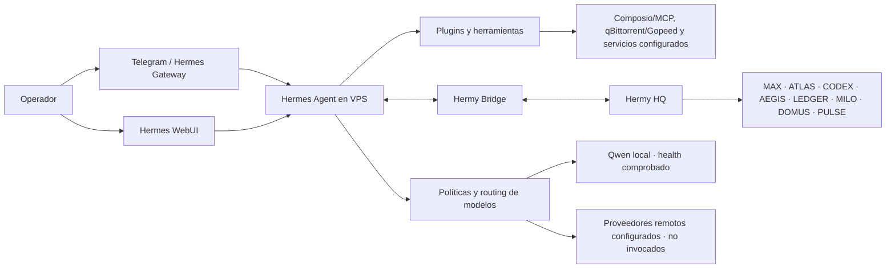

# Hermes Agent personalizado

Hermes Agent es un proyecto de Nous Research. La marca, el banner y el diseño pertenecen a sus titulares.

Este repositorio presenta un snapshot público y filtrado de **Hermes Agent personalizado**: el agente de código abierto de [Nous Research](https://github.com/NousResearch/hermes-agent), ampliado con plugins e integraciones desarrollados para el entorno de REY. La documentación separa las funciones upstream de las personalizaciones y señala qué se observó, qué se probó y qué permanece sin validar.

El snapshot no es una exportación completa ni reproducible del VPS. Excluye datos de runtime, credenciales, conversaciones, bases de datos y configuraciones privadas. La auditoría del 20 de noviembre de 2026 no pudo asociar el árbol productivo a un tag o commit upstream exacto. Las correcciones locales posteriores de dependencias se conservan fuera de esta publicación y **no fueron desplegadas en producción**.

## Hermes Agent de Nous Research

El proyecto original aporta el runtime y sus interfaces: CLI, Gateway, WebUI y Desktop; sesiones, memoria y Wiki; herramientas, skills y plugins; navegación y automatización; subagentes, integraciones MCP y proveedores de modelos; además de mecanismos de gestión y compresión del contexto. Estas capacidades pertenecen a Nous Research, no a las personalizaciones de REY.

Consulta el [repositorio upstream](https://github.com/NousResearch/hermes-agent) y su [documentación oficial](https://hermes-agent.nousresearch.com/docs/).

## Aportes y estado observado

La auditoría registró 42 elementos. En ese corte, 7 se verificaron dentro de un alcance limitado, 25 estaban implementados sin validación E2E, 5 eran parciales, 4 estaban inactivos y 1 no se encontró. Los estados no describen disponibilidad actual y no equivalen a una certificación.

| Área | Aporte de REY | Estado y límite de la evidencia |
|---|---|---|
| Coordinación multiagente | Integración con Hermy HQ, su Bridge y ocho roles especialistas | Catálogo y componentes presentes; no se acreditó la ejecución E2E de cada agente. |
| Composio y MCP | Router bajo demanda con descubrimiento de herramientas y ruta de lectura | Configurado; no se hicieron consultas externas durante la auditoría. |
| Telemetría | Plugin local que conserva metadatos de uso y evita persistir mensajes y argumentos | Código y plugin habilitados; exportación completa no probada. |
| Herramientas | Research gate y guardrails para llamadas de herramientas | Código presente; sin validación E2E ni certificación de seguridad. |
| Multimedia | Búsqueda y control de qBittorrent, Gopeed y flujo de selección | 72 pruebas aisladas aprobadas; no se inició una descarga real. |
| Presencia e impresión | Referencias a plugins de presencia e impresión en el catálogo observado | No se probó su ejecución E2E; los módulos de dispositivo se mantienen fuera de este snapshot. |
| Video2Implementation | Flujo relacionado con videos de YouTube y Gemini | Parcial; Gemini estaba deshabilitado en el corte. |
| Weekly Movies | Catálogo y automatización asociados con TMDB | Timer y artefactos observados; la entrega no se verificó. |
| Comunicación | Telegram mediante Gateway y soporte configurado para WhatsApp | No se enviaron mensajes de prueba. |
| Productividad | Job-Apply, preparación/selección de CV y conexión prevista con Google Calendar | El worker Job-Apply tenía un timer activo, pero no se verificó ninguna postulación; Calendar era parcial. |
| Hogar y dispositivos | Integraciones configuradas para Home Assistant, Alexa y Fire TV/ADB | No se ejecutaron controles; componentes ligados a dispositivos privados se excluyeron del snapshot. |
| Operación | Nodos subordinados, supervisión, respaldos, heartbeat y tareas programadas | Se observaron componentes y timers; recuperación, cobertura e2e y continuidad no quedaron acreditadas. |
| Modelos | Routing local/remoto con políticas y fallbacks configurados | Qwen respondió a una comprobación de salud HTTP 200; no se hizo inferencia. Otros proveedores no se llamaron. |

El inventario completo, los 42 estados y sus evidencias están en **[Capacidades y estado técnico](docs/CAPABILITIES-2026-11-20.md)**. Los cinco plugins adicionales publicados en `customizations/plugins/` son el router Composio, telemetría, control qBittorrent, research gate y tool-call guardrails. El snapshot también conserva personalizaciones anteriores en `custom/plugins/`; no todos los componentes presentes en producción se publican. Los destinos de descarga por defecto son `~/Videos` y `~/Downloads`; se configuran para el filesystem visible para qBittorrent mediante los ajustes del plugin descritos en la guía de despliegue.

El snapshot también publica una skill propia de respuesta defensiva a incidentes, junto con su licencia y una prueba de formato. Es una guía operativa para análisis autorizado; no es un playbook automatizado ni una integración SOC validada E2E. El índice explica por qué otras skills locales con procedencia, licencia o integraciones privadas no se incluyen: **[Skills publicadas y alcance](customizations/skills/README.md)**.

## Arquitectura

El diagrama resume componentes y relaciones encontradas, no confirma cada conexión extremo a extremo. La configuración efectiva y las direcciones privadas no se publican. La administración de GitHub se realizó desde la Dell; Hermes y Hermy HQ productivos permanecen en el VPS.

## Modelos y control de costes

Qwen local respondió al endpoint de salud, pero no se generó una respuesta de modelo. TokenHarbor/DeepSeek, OpenRouter, Groq, Cerebras y FreeLLMAPI aparecían configurados en rutas o referencias; no se comprobó su disponibilidad mediante llamadas. Las rutas gratuitas dependen de cuotas y condiciones del proveedor y no garantizan coste cero. La auditoría no reconcilió costes reales.

## Canales, aprobaciones y límites

Telegram y WebUI forman parte del despliegue observado; la WebUI respondió al health check y su API rechazó solicitudes sin autenticación. No se mandaron mensajes a Telegram o WhatsApp ni se validó un ciclo completo de interacción. En Hermy HQ, `AUTOAPPROVAL_ENABLED=false` en el corte auditado; esto no certifica todas las rutas de autorización. El inventario documenta las limitaciones de Action Center, scheduler y agentes.

No se verificaron E2E el correo MILO, Google Calendar, postulaciones, restauración de backups, control de hogar o Fire TV, ni cada ruta de proveedores. El estado de cada uno se presenta en el inventario con la evidencia disponible.

## Publicación, configuración y seguridad

- [Inventario de Hermes: funciones, estados, arquitectura y evidencia](docs/CAPABILITIES-2026-11-20.md)
- [Hermy HQ: agentes y estado auditado](https://github.com/Reynaldo8509/hermy-hq-personalized/blob/main/docs/AGENTS-STATUS-2026-11-20.md)
- [Guía de despliegue y configuración](docs/DEPLOYMENT.md)
- [Política de seguridad](SECURITY.md)
- [Home Assistant personalizado](https://github.com/Reynaldo8509/home-assistant-personalized)

Los ejemplos deben configurarse con credenciales propias y servicios aislados. No publiques archivos `.env` reales, sesiones, claves, historial de conversación, datos personales, bases de datos, respaldos o configuración privada. La publicación conserva avisos y licencias upstream; atribuye a Nous Research el proyecto original y a terceros sus respectivos componentes.

El workflow del repositorio valida artefactos de publicación y escanea las líneas añadidas para patrones comunes de credenciales. Este control reduce errores de publicación, pero no sustituye una revisión de privacidad ni una auditoría de seguridad.
