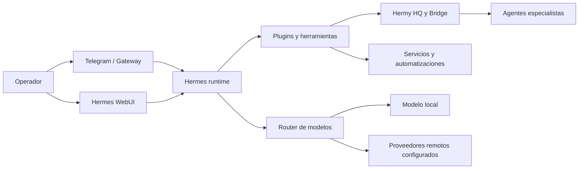

# Capacidades y estado técnico — Hermes Agent personalizado

**Fecha de corte:** 20 de noviembre de 2026 · **Alcance:** inventario de código, configuración, servicios y pruebas limitadas realizado desde Dell G15 sobre el VPS Oracle. No es una certificación de seguridad ni una prueba integral de extremo a extremo.

Hermes Agent es un proyecto de código abierto de [Nous Research](https://github.com/NousResearch/hermes-agent). Este repositorio muestra una instalación extendida con componentes propios de REY. Debe distinguirse la funcionalidad del proyecto original del código y las políticas añadidas localmente.

## 1. Capacidades originales de Hermes

El proyecto upstream proporciona el motor del agente y sus interfaces de uso: CLI, Gateway, WebUI, Desktop, sesiones, memoria y contexto, Wiki, herramientas, skills/plugins, navegadores y automatización, subagentes, MCP, proveedores de modelos y mecanismos de gestión del contexto. **Estas funciones no son desarrollos originales de REY.**

Documentación oficial: [herramientas](https://hermes-agent.nousresearch.com/docs/user-guide/features/tools) · [configuración](https://hermes-agent.nousresearch.com/docs/user-guide/configuration) · [compresión/caché](https://hermes-agent.nousresearch.com/docs/developer-guide/context-compression-and-caching).

**Versión exacta instalada:** no recuperable de forma fiable en la auditoría. El paquete indica `0.0.0`, pero el árbol productivo exportado carece de historial Git que permita asociarlo a un tag oficial. No debe presentarse como versión `0.0.0` publicada upstream ni atribuirse automáticamente el release más reciente.

## 2. Personalizaciones e integraciones

El sistema incorpora, según las configuraciones y fuentes inspeccionadas, plugins y flujos para:

- **Coordinación:** integración con [Hermy HQ](https://github.com/Reynaldo8509/hermy-hq-personalized), despacho por especialistas, políticas de modelos y observabilidad.
- **Herramientas y conectores:** router de Composio bajo demanda, controles de llamadas, investigación, telemetría y referencias a plugins de presencia e impresión; búsquedas y conexiones externas sujetas a permisos.
- **Multimedia:** búsquedas y control de descargas mediante qBittorrent/Gopeed, catálogo semanal TMDB y flujo Video2Implementation para YouTube.
- **Comunicación:** Telegram como canal del Gateway, asistente de soporte WhatsApp y notificaciones, bajo configuraciones de acceso independientes.
- **Productividad:** correo mediante MILO, preparación de candidaturas mediante Job-Apply, selección/generación de CV y conexión preparada con Google Calendar.
- **Hogar y red:** Home Assistant, Alexa, control de Fire TV mediante ADB, presencia y rutas de dispositivos subordinados.
- **Operación:** respaldos, tareas programadas, supervisores, diagnósticos y heartbeat.

Esta enumeración combina funcionalidades verificadas, parciales y deshabilitadas: **no implica que todas hayan superado una prueba E2E**. Algunos plugins contienen referencias a identidades o dispositivos privados y por eso no se exportan al repositorio público.

## 3. Inventario de auditoría

**Estados:** IMPLEMENTADO Y VERIFICADO significa que la evidencia indicada pasó dentro de un alcance limitado; IMPLEMENTADO SIN VALIDACIÓN E2E indica código/configuración sin una prueba integral; PARCIAL indica cobertura incompleta; INACTIVO indica deshabilitado o sin ejecución al corte; NO ENCONTRADO indica que no se halló evidencia. Ninguna etiqueta certifica todos los casos de uso.

| # | Elemento | Estado | Alcance observado |
|---:|---|:---:|---|
| 1 | Hermes CLI/runtime | IMPLEMENTADO Y VERIFICADO | Servicio y paquete presentes; versión upstream indeterminada |
| 2 | Gateway Hermes | IMPLEMENTADO Y VERIFICADO | Unidad activa; sin mensaje externo de prueba |
| 3 | WebUI | IMPLEMENTADO Y VERIFICADO | Health HTTP 200; API protegida responde 401 sin autenticación |
| 4 | Sesiones, memoria y Wiki | IMPLEMENTADO SIN VALIDACIÓN E2E | Código/configuración; datos privados no inspeccionados |
| 5 | Catálogo de plugins | IMPLEMENTADO Y VERIFICADO | Registro/directorios inspeccionados, con referencias a presencia e impresión; no todos los plugins probados |
| 6 | Router Composio bajo demanda | IMPLEMENTADO SIN VALIDACIÓN E2E | Configurado; sin consulta externa |
| 7 | Telemetría Hermes | IMPLEMENTADO SIN VALIDACIÓN E2E | Plugin habilitado; exportación no probada |
| 8 | Guardrails de herramientas | IMPLEMENTADO SIN VALIDACIÓN E2E | Código presente; sin E2E |
| 9 | Research gate | IMPLEMENTADO SIN VALIDACIÓN E2E | Presente; sin investigación externa |
| 10 | Control qBittorrent | IMPLEMENTADO Y VERIFICADO | Suite aislada 72/72; sin descarga real |
| 11 | Gopeed | IMPLEMENTADO SIN VALIDACIÓN E2E | Integración/configuración observada |
| 12 | Video2Implementation | PARCIAL | Código y pruebas; integración audiovisual restringida |
| 13 | Gemini para vídeo | INACTIVO | Ruta de ejecución deshabilitada |
| 14 | Weekly Movies / TMDB | IMPLEMENTADO SIN VALIDACIÓN E2E | Timer y artefactos presentes; sin validar entrega |
| 15 | Composio / MCP | IMPLEMENTADO SIN VALIDACIÓN E2E | Servidor configurado; sin acciones externas |
| 16 | Correo MILO | INACTIVO | Temporizador de correo inactivo |
| 17 | Worker Job-Apply | IMPLEMENTADO SIN VALIDACIÓN E2E | Timer periódico con ejecución previa exit 0; sin postulación real verificada |
| 18 | Selección y generación de CV | IMPLEMENTADO SIN VALIDACIÓN E2E | Módulos presentes; sin candidatura enviada |
| 19 | Google Calendar | PARCIAL | Integración completa no acreditada en esta auditoría |
| 20 | Soporte WhatsApp | IMPLEMENTADO SIN VALIDACIÓN E2E | Plugin/configuración; sin mensajes de prueba |
| 21 | Home Assistant | IMPLEMENTADO SIN VALIDACIÓN E2E | Plugin presente; respuesta HTTP raíz, sin control de dispositivos |
| 22 | Alexa | PARCIAL | Integración presente; no probada; datos privados excluidos |
| 23 | Fire TV / ADB | INACTIVO | Unidad observada sin control E2E |
| 24 | Nodos subordinados | IMPLEMENTADO SIN VALIDACIÓN E2E | Routers presentes; sin despertar dispositivos |
| 25 | Supervisión y alertas | IMPLEMENTADO SIN VALIDACIÓN E2E | Servicios/timers observados; sin incidente de prueba |
| 26 | Respaldos | IMPLEMENTADO SIN VALIDACIÓN E2E | Última ejecución exit 0; restauración no probada |
| 27 | Heartbeat del Gateway | IMPLEMENTADO SIN VALIDACIÓN E2E | Timer presente; cobertura histórica sin acreditar |
| 28 | EXCELNT egress | PARCIAL | Servicio egress activo; monitor de disponibilidad fallido |
| 29 | Worker CODEX en HQ | IMPLEMENTADO SIN VALIDACIÓN E2E | Servicio activo; sin despachar tarea |
| 30 | Autoaprobación HQ | INACTIVO | Deshabilitada en la configuración observada |
| 31 | Action Center y aprobaciones | IMPLEMENTADO SIN VALIDACIÓN E2E | Código existente; ciclo completo no probado |
| 32 | Scheduler HQ | IMPLEMENTADO SIN VALIDACIÓN E2E | Timers activos; API HQ sin health confirmado |
| 33 | Métricas y costes | PARCIAL | Código presente; métricas reales sin reconciliar |
| 34 | Qwen local | IMPLEMENTADO Y VERIFICADO | Endpoint health HTTP 200; sin inferencia |
| 35 | TokenHarbor / DeepSeek gratuito | IMPLEMENTADO SIN VALIDACIÓN E2E | Ruta configurada; proveedor no consultado |
| 36 | OpenRouter fallback | IMPLEMENTADO SIN VALIDACIÓN E2E | Configurado; disponibilidad no probada |
| 37 | Groq / Cerebras / FreeLLMAPI | IMPLEMENTADO SIN VALIDACIÓN E2E | Referencias/rutas presentes; sin llamadas |
| 38 | Ruta de modelo CODEX | IMPLEMENTADO SIN VALIDACIÓN E2E | Configuración del worker; sin ejecución |
| 39 | Routing de MAX / ATLAS | IMPLEMENTADO SIN VALIDACIÓN E2E | Política y tests offline; sin proveedor E2E |
| 40 | Bases SQLite | IMPLEMENTADO SIN VALIDACIÓN E2E | Esquemas y recuentos inspeccionados, sin leer datos personales |
| 41 | Sanitización de logs | IMPLEMENTADO Y VERIFICADO | Resumen de logs acotado; no garantiza ausencia total de fallos |
| 42 | Versión/commit upstream exacto | NO ENCONTRADO | Árbol productivo sin `.git`; no recuperable |

**Balance de los 42 elementos evaluados:** 7 IMPLEMENTADO Y VERIFICADO, 25 IMPLEMENTADO SIN VALIDACIÓN E2E, 5 PARCIAL, 4 INACTIVO y 1 NO ENCONTRADO. Esta tabla es una fotografía de la auditoría del 20 de noviembre de 2026, no un marcador de disponibilidad actual ni de completitud del producto.

## 4. Código publicado y límites de reproducción

El repositorio conserva el snapshot original documentado en `README.md` y `docs/DEPLOYMENT.md`. Las correcciones de dependencias preparadas después de ese snapshot permanecen en una rama local de respaldo, no se incluyeron en esta publicación y no se desplegaron en producción. Las vulnerabilidades reportadas en dependencias upstream pertenecen a una revisión separada; esta publicación documental no las reevalúa ni afirma que el árbol actual esté libre de avisos. El PR de sincronización de noviembre añade cinco plugins genéricos en `customizations/plugins/`: router Composio, telemetría, control qBittorrent, research gate y guardrails. La ubicación histórica `custom/plugins/` sigue documentada para componentes del snapshot anterior.

La cifra de **20 plugins propios habilitados en producción**, indicada en el informe de auditoría, no significa que los 20 estén publicados ni validados extremo a extremo. Los ejemplos de qBittorrent usan `~/Videos` y `~/Downloads` como destinos genéricos; si el servicio ve otros montajes, configura los ajustes `media_path` y `downloads_path` del plugin en `plugins.entries.qbittorrent-control.settings`. El código publicado es un **subconjunto filtrado**; no incluye credenciales, sesiones, bases de datos, información personal, configuración de redes privadas o datos de runtime.

## 5. Arquitectura pública

Las flechas representan relaciones de arquitectura, **no validación E2E de cada integración**. La configuración real y los endpoints privados no se publican.

## 6. Pruebas y cuestiones pendientes

- qBittorrent: **72/72 pruebas aisladas**. No se realizó ninguna descarga para esta auditoría.
- Hermy HQ: la revisión posterior registró **293 pruebas aprobadas, 0 fallidas y 1 omitida** en una suite aislada; no sustituye una prueba integral de producción. El documento vigente está en [su repositorio](https://github.com/Reynaldo8509/hermy-hq-personalized/blob/main/docs/AGENTS-STATUS-2026-11-20.md).
- Qwen y WebUI: **HTTP health 200**; no se consumieron completions de modelos comerciales.
- No se acreditaron E2E de WhatsApp, Telegram, correo, Calendar, Job-Apply, hogar, backup restore o cada agente.
- Job-Apply tenía un timer activo en el momento de corte; **no se debe presentar como detenido** ni como una campaña que haya enviado postulaciones.
- La activación de Gemini/Video2Implementation y la recuperación de EXCELNT requieren validaciones independientes.

## 7. Referencias y seguridad

- [Hermes upstream — Nous Research](https://github.com/NousResearch/hermes-agent)
- [Hermy HQ personalizado](https://github.com/Reynaldo8509/hermy-hq-personalized)
- [Home Assistant personalizado](https://github.com/Reynaldo8509/home-assistant-personalized)
- [Guía de despliegue del repositorio](DEPLOYMENT.md) 
- [Política de publicación segura](../SECURITY.md)

Este material es documentación de portafolio y un snapshot técnico sanitizado. **No permite reproducir el entorno personal exacto ni restaurar su estado privado.**
